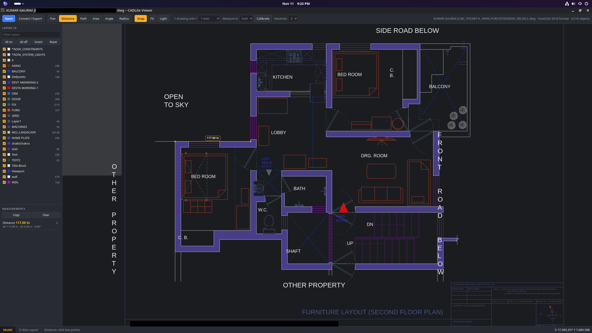

# CADLite Viewer (beta)

**A free, lightweight DWG and DXF viewer for Linux.** Open a drawing, switch
between Model and layout sheets, turn layers on and off, and take real
measurements, without Windows, Wine or a CAD licence.

## What it does

- Opens **DWG** (R12 to 2018+) and **DXF**
- **Model and layout tabs**, with viewports shown at their scale
- **Layers**: on/off, filter, isolate, reset
- **Measure** distance, path length, area, angle and radius, with snapping to
  end, mid, centre and intersection points
- **Units**: mm, cm, m, inch, feet, plus a Calibrate tool for drawings with an
  unknown scale
- **Convert** between DWG/DXF versions; export SVG and PNG
- Runs locally: your drawings never leave your computer

> **Beta.** Built for 2D review, not editing. Xrefs, 3D solids, images and true
> hatch patterns are not shown yet (see Known limits). The code was written
> with AI assistance. If a drawing opens wrongly, please open an
> [issue](../../issues).

| Layout sheet with viewport | One-click DWG setup |
|---|---|
|  |  |

## Install

Any Linux (Bazzite, Fedora, Arch, openSUSE ...), no root needed:

    curl -LO https://github.com/kumargauarv85/cadlite/releases/download/v1.4.0/cadlite-1.4.0-linux.tar.gz
    tar xzf cadlite-1.4.0-linux.tar.gz
    cd cadlite-1.4.0
    ./install.sh

Ubuntu / Debian / Mint / Pop!_OS:

    curl -LO https://github.com/kumargauarv85/cadlite/releases/download/v1.4.0/cadlite_1.4.0_all.deb
    sudo apt install ./cadlite_1.4.0_all.deb

Start it from the application menu ("CADLite Viewer"), by right-clicking a
.dwg/.dxf file and choosing "Open With", or from a terminal: `cadlite plan.dwg`.
To remove it: `./install.sh --uninstall` (or `sudo apt remove cadlite`).

Requirements: Python 3.6+. CADLite opens in its own small native window when
the system has GTK with WebKitGTK and PyGObject (standard on GNOME desktops,
including Bazzite GNOME). Otherwise it uses a Chromium-family browser in app
mode (Chrome, Chromium, Brave, Edge, Vivaldi; native or Flatpak), then Firefox
or your default browser. `cadlite --browser` forces the browser. In the native
window, saved and exported files go to your Downloads folder.
The viewer talks only to a private service on 127.0.0.1.

## DWG files and version conversion

DXF files open straight away. DWG is a closed format, so CADLite uses the free
ODA File Converter as its engine for opening DWG and saving other versions
(R12 to 2018+). Set it up once, from inside the app:

* Click **Convert / Export > Set up DWG support** (or just open a DWG file and
  press the button that appears). CADLite downloads the engine from
  opendesign.com into ~/.local/share/cadlite/engine and unpacks it. Nothing
  else to install; it needs an internet connection only this one time.
* Terminal alternative: `cadlite --setup-dwg`
* Already have the ODA AppImage, or LibreDWG (`dwg2dxf`)? CADLite detects them
  too. A custom path can be set under "Use a converter you already have".

The engine is ODA's software and is used under ODA's terms. Its window may
flash briefly during a conversion on systems without `xvfb`.

Built in, no converter needed: SVG (vector), PNG, and a simple R12 DXF.

Command-line conversion: `cadlite in.dwg --convert out.dxf DXF ACAD2013`
(formats DWG, DXF, DXB; versions ACAD12, ACAD14, ACAD2000, ACAD2004, ACAD2007,
ACAD2010, ACAD2013, ACAD2018).

## Using it

* Pan: drag. Zoom: mouse wheel. Fit: F or double-click.
* Layers: tick/untick; double-click a name to show only that layer; Reset
  returns to the state saved in the file.
* Tabs at the bottom switch between Model and the drawing's layouts.
* Measuring: D distance, P path, A area, G angle, R radius. Enter or
  double-click finishes, Esc cancels, Backspace removes the last point, S
  toggles snap. Inside a layout viewport, results are real model units at the
  viewport's scale; across the sheet they are paper units.
* Placing a distance: after the two points, move the pointer away and click
  to set the dimension line clear of the drawing (Enter keeps it on the
  points). Drag any measurement label later to move it.
* Units: "1 drawing unit =" says what one unit in the file stands for (read
  from the file when it states it, otherwise assumed mm); "Measure in" is the
  unit results are converted to. If numbers look wrong, press Calibrate, click
  the two ends of a length you know, and type its real value.
* Own window: CADLite opens in its own window when a Chromium-family browser
  is installed (Chrome, Chromium, Brave, Edge, Vivaldi; native or Flatpak).
  With only Firefox it opens as a browser tab.

## Known limits

2D viewer: 3D solids/surfaces (ACIS), images, OLE objects, XLINE/RAY and
MLINE are not drawn; 3D geometry is shown in plan. Hatch patterns are shown
as a light tint, text uses a system font, line weights are not shown, and
viewports are clipped to their rectangle and assumed to look straight down.

## Licence

MIT. The optional DWG engine (ODA File Converter) is separate software from the Open Design Alliance, downloaded by the user under ODA's own terms.
